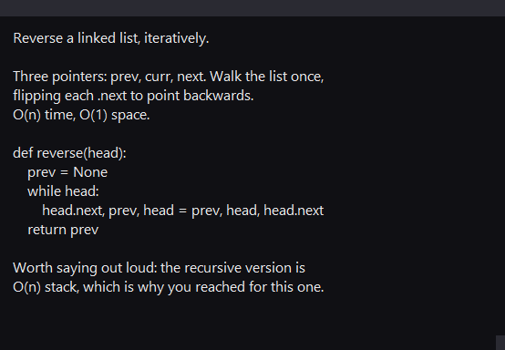
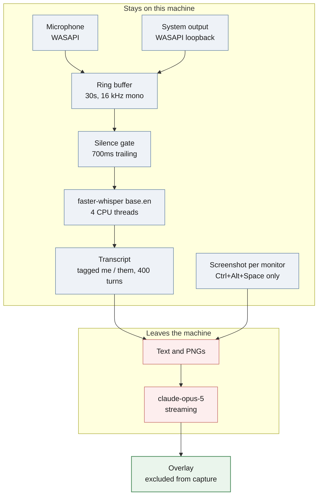

<div align="center">

# Local meeting assistant

**Hears both sides of a call, transcribes it locally with whisper,
and answers into a window that screen capture cannot see.**




<sub>The overlay itself, with an illustrative cue card in it.
Screen capture normally cannot see this window at all.</sub>

<br>

[Requirements](#requirements) &nbsp;·&nbsp;
[Setup](#setup) &nbsp;·&nbsp;
[Hotkeys](#hotkeys) &nbsp;·&nbsp;
[How it works](#how-it-works) &nbsp;·&nbsp;
[Screen mode](#screen-mode) &nbsp;·&nbsp;
[The overlay](#the-overlay) &nbsp;·&nbsp;
[Tuning](#tuning) &nbsp;·&nbsp;
[Tests](#tests) &nbsp;·&nbsp;
[Scope](#scope)

</div>

---

The audio never leaves the machine. It is captured, buffered, and transcribed
on the local CPU, and only the resulting text goes to the API, plus a
screenshot when you ask for one.

| | |
|:---|:---|
| **Hears** | Your microphone and the system output, as two separate streams |
| **Transcribes** | `faster-whisper base.en`, locally, on 4 CPU threads |
| **Answers** | `claude-opus-5`, streamed token by token |
| **Shows** | A borderless overlay that `WDA_EXCLUDEFROMCAPTURE` keeps out of screen shares |
| **Costs** | About $0.010 per screen-mode press |

## Requirements

Windows 10 build 19041 or later, for `WDA_EXCLUDEFROMCAPTURE`. CPU only, no GPU
needed.

> [!WARNING]
> **Use headphones.**
>
> On speakers the microphone hears the other person's voice coming back out of
> them, so every question they ask is transcribed twice, once as `[them]` and
> again as `[me]`. That breaks the core feature. <kbd>Ctrl</kbd>+<kbd>Space</kbd>
> looks for the last question `[them]` asked that `[me]` has not answered, and a
> duplicate under your own tag makes it look answered. Measured, not
> theoretical: a sentence played through the speakers came back under both tags.

## Setup

```bash
uv sync
export ANTHROPIC_API_KEY=sk-ant-...
export ASSISTANT_NAME="Your Name"
uv run meeting-assistant
```

> [!NOTE]
> The key is read at call time and never stored in module state. A missing
> `ANTHROPIC_API_KEY` fails immediately on startup with a clear error rather
> than on the first hotkey press.

## Hotkeys

Global, so they work while another window has focus.

| Key | Does |
|:---|:---|
| <kbd>Ctrl</kbd>+<kbd>Space</kbd> | Answer the last question they asked |
| <kbd>Ctrl</kbd>+<kbd>Shift</kbd>+<kbd>Space</kbd> | Answer a typed question, using the transcript |
| <kbd>Ctrl</kbd>+<kbd>Alt</kbd>+<kbd>Space</kbd> | Read the screen and answer what's on it, in code |
| <kbd>Ctrl</kbd>+<kbd>Alt</kbd>+<kbd>H</kbd> | Hide or show the overlay |
| <kbd>Ctrl</kbd>+<kbd>Alt</kbd>+<kbd>Q</kbd> | Quit |

Pressing an answer key again while one is still streaming supersedes it. The
older answer stops writing mid-token instead of interleaving with the new one.

The rest work on the overlay itself, under the mouse.

| Gesture | Does |
|:---|:---|
| drag the top bar | Move it. The strip along the top, since there is no titlebar |
| drag the corner grip | Resize it. The small square, bottom right |
| <kbd>Ctrl</kbd> + scroll | Bigger or smaller text, 8pt to 32pt |
| <kbd>Shift</kbd> + scroll | See through it, down to 25% and never further |
| drag across the text | Select it. <kbd>Ctrl</kbd>+<kbd>C</kbd> copies |

## How it works



Two WASAPI streams run at once, your microphone and a loopback tap on the
system output, both resampled to the 16 kHz mono that whisper and the silence
gate require. Each lands in its own 30 second ring buffer.

A gate watches for 700ms of trailing silence and hands the closed utterance to
whisper. An unbroken monologue is forced through after 30 seconds so a long
answer still gets transcribed. Turns accumulate into an in-memory transcript
tagged by source, capped at 400.

When you press a hotkey, the transcript and any screenshots are assembled into
one request. The system prompt carries a one hour cache marker, so repeated
presses reuse it. Tokens stream back into the overlay as they arrive.

| Module | Job |
|:---|:---|
| `capture.py` | Dual WASAPI capture, microphone and system output |
| `audio_ring.py` | Rolling window of mono float32, safe across threads |
| `transcribe.py` | Silence gating and local transcription into tagged turns |
| `screen.py` | One PNG per monitor for the vision hotkey |
| `prompts.py` | System prompts, built once at import |
| `answer.py` | Request assembly and token streaming |
| `overlay.py` | The capture-excluded window and every gesture on it |
| `main.py` | Wiring, hotkeys, and the supersede guard |

## Screen mode

<kbd>Ctrl</kbd>+<kbd>Alt</kbd>+<kbd>Space</kbd> sends a screenshot of every monitor **and** the transcript. The
screen carries the signature, the starter code, the error. The transcript
carries the constraints that are only ever spoken, things like "no built-ins" or
"optimize for memory". Neither alone is enough, which is why both go.

It answers under a second system prompt that writes real code instead of the
spoken cue cards <kbd>Ctrl</kbd>+<kbd>Space</kbd> produces. On a diagram or a dashboard it falls
back to bullets on its own.

Monitors are sent as one image each, never stitched into one wide picture.

<details>
<summary>Why stitching breaks it</summary>

<br>

Two 1920-wide screens stitched are 3840 across, and the API scales anything past
1568 on the long edge, which lands the pair at 441px tall. That is too short to
read code off. Separate images each get their own scaling budget.

</details>

### Half resolution saves money, not time

> [!IMPORTANT]
> An earlier note here claimed half resolution made answers about twice as
> fast. That was wrong: it compared two different questions with different
> answer lengths. The corrected A/B is below.

Screenshots go at half resolution by default (`SCREEN_HALF_RES`). Controlled
A/B on one 1536x864 monitor, same question, four runs each, alternating:

| | input tokens | TTFT (median) | total (median) |
|:---|---:|---:|---:|
| full res | 2847 | 2.05s | 3.43s |
| **half res** | **856** | 1.80s | 3.34s |

The token drop is deterministic and worth about $0.010 a press. The wall-clock
difference is not. The totals overlap run to run, and one full-res run came back
faster than both half-res runs. Legibility was tested rather than assumed: at
half resolution the model still transcribed a 14pt IDE-font stub correctly. Set
it `False` if a real pad ever reads worse.

There is no large speed win available here. Output dominates, a screen answer is
typically 3 to 4 seconds end to end, and the one real lever is `FAST_MODE`,
which needs an entitlement this account does not have.

## The overlay

A borderless always-on-top window, 460x300 at startup, hidden from screen
capture by `SetWindowDisplayAffinity`. It refuses to start if that call fails
rather than showing itself unprotected.

<details>
<summary>Why the handle decides everything else</summary>

<br>

Display affinity lives on the window handle, which shapes the rest of the
design. Hiding uses alpha rather than unmapping, because remapping can hand back
a different handle and silently drop the exclusion. The typed-query box is
packed inline rather than opened as a dialog, because a second window would be a
second handle and would not inherit the exclusion.

</details>

> [!TIP]
> **If it disappears behind another window**, press
> <kbd>Ctrl</kbd>+<kbd>Alt</kbd>+<kbd>H</kbd> twice, or any answer hotkey. Both
> re-raise it.

<details>
<summary>Why raising is manual and not on a timer</summary>

<br>

Nothing can detect that it got buried, since Tk reports the window as topmost
and viewable the whole time another app covers it, so raising is something you
trigger rather than something the app notices. It is deliberately not on a
timer: a window that reclaims the front every second fights every other topmost
window on your desktop.

</details>

The overlay never appears in its own screenshots either. `WDA_EXCLUDEFROMCAPTURE`
covers that capture path too, so the model cannot read its own last answer back.
Verified by sampling the pixel under the overlay with exclusion on and off.

### What it does not hide

> [!CAUTION]
> Exclusion covers screen capture and screen share. It does not cover an HDMI
> capture card, a camera pointed at the screen, or your eyes tracking text.

## Tuning

Everything adjustable is in `assistant/config.py`.

| Symptom | Change |
|:---|:---|
| Transcription too inaccurate | `WHISPER_MODEL = "distil-small.en"` |
| Machine bogged down | Lower `WHISPER_THREADS` (4 today) |
| Cut off mid-sentence | Raise `SILENCE_END_MS` (700ms today) |
| Want lower latency, at some CPU cost | Lower `GATE_POLL_S` |
| Screenshots reading badly | `SCREEN_HALF_RES = False` |
| Debugging the overlay | `EXCLUDE_FROM_CAPTURE = False` |
| Got fast-mode access | `FAST_MODE = True` |

Reach for `SILENCE_END_MS` first if it keeps interrupting you. At 700ms a
natural pause mid-question splits one question into two turns.

<details>
<summary>One knob with a catch</summary>

<br>

`FAST_MODE` is off by default because without the entitlement every request
fails with `rate limit of 0 fast mode input tokens per minute`. That is
unusable, not merely slower.

</details>

### What it remembers

Window size, position, font size and opacity are written to
`%LOCALAPPDATA%\meeting-assistant\ui.json` and restored next launch. Delete that
file to get the defaults back.

Everything read from it is re-clamped on the way in, against the monitors you
have *now*. A saved position on a monitor you have since unplugged gets pulled
back on screen, and a hand-edited `"alpha": 0` is raised to the floor. The file
is otherwise a way to hand yourself an invisible or unreachable window, since
the overlay has no titlebar to recover it by.

## Tests

```bash
uv run pytest -q          # 148 tests, about 5 seconds
uv run ruff check .
```

The overlay tests drive a real Tk window rather than a mock: the drag and
resize gestures, the wheel bindings, selection and clipboard, and the raise
path.

<details>
<summary>The one thing tests cannot cover</summary>

<br>

They run with `EXCLUDE_FROM_CAPTURE` turned off, because an excluded window
cannot be screenshotted and therefore cannot be checked by a test. Exclusion
itself is verified by hand instead, by sampling the pixel under the overlay with
the flag on and again with it off. `docs/verification-checklist.md` lists which
checks are scripted and which still need a person.

</details>

Tests that pin a property rather than a return value are checked by breaking the
property on purpose and confirming the test goes red. That discipline caught
four tests here that passed against deliberately broken code, so a green run is
not taken as evidence on its own.

## Building an exe for someone else

```powershell
.\build.ps1        # dist\meeting-assistant.zip, about 100 MB
```

A folder build, not one file: a one-file exe unpacks ~250MB to `%TEMP%` on
every launch and is the main antivirus false-positive trigger. Unsigned either
way, so SmartScreen warns once on a new machine.

The recipient supplies their own Anthropic key, asked for once at first launch
and stored via Windows DPAPI in `%LOCALAPPDATA%\meeting-assistant\key.bin`,
encrypted against their Windows account. `ANTHROPIC_API_KEY` still wins if set,
so nothing changes for development. The speech model downloads on first run
with a notice in the overlay.

`DISTRIBUTING.md` ships alongside the exe as `READ ME FIRST.txt`. It carries
the consent and screen-share points, which matter more to someone who did not
build this than to you.

> [!CAUTION]
> Handing this to other people widens the scope note below. Recording both
> sides of a call is not legal everywhere on one party's consent, and the
> capture-exclusion feature is normally a policy breach for whoever is on the
> other end of an interview.

## Scope

Personal use. Pointing this at work calls reopens the consent and
recording-policy question, which is a separate decision.

Recording both sides of a conversation is not legal everywhere on one
participant's consent, and a window the other side cannot see is normally
against the rules of whoever is running an interview or a proctored exam,
whatever the law says where you are. Both are worth deciding on purpose.

## License

MIT, see [LICENSE](LICENSE). Provided as is, with no warranty.
